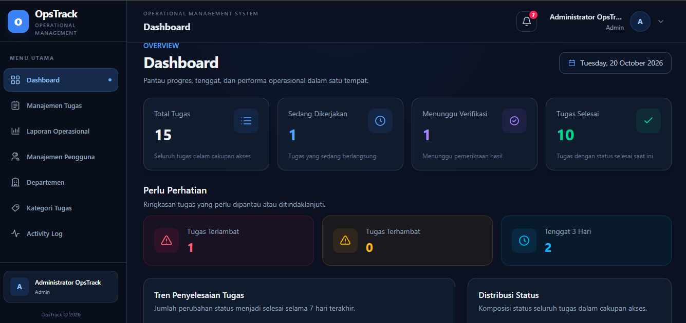

# OpsTrack — Sistem Pemantauan Kinerja Operasional

OpsTrack adalah aplikasi web untuk membantu organisasi mengelola tugas operasional, memantau perkembangan pekerjaan, mengawasi tenggat waktu, melakukan verifikasi penyelesaian tugas, serta mengevaluasi kinerja operasional melalui dashboard terpusat.

Sistem ini dikembangkan menggunakan Laravel dan MySQL dengan menerapkan pembagian hak akses berdasarkan peran pengguna. OpsTrack dirancang untuk mendukung alur kerja yang lebih terstruktur, transparan, dan mudah dipantau, mulai dari pemberian tugas hingga verifikasi penyelesaiannya.

## Tampilan Dashboard

Dashboard OpsTrack menyajikan ringkasan aktivitas operasional, statistik tugas, tren penyelesaian pekerjaan, serta informasi tugas yang membutuhkan perhatian. Melalui dashboard ini, pengguna dapat memantau kondisi operasional dengan lebih mudah.

<p align="center">
  
</p>

## Fitur Utama

### 1. Dashboard dan Pemantauan Kinerja

- Menampilkan indikator utama, seperti jumlah seluruh tugas, tugas yang sedang dikerjakan, tugas yang menunggu verifikasi, dan tugas yang telah selesai.
- Memantau tugas yang melewati tenggat waktu, mengalami kendala, atau mendekati tenggat waktu.
- Menampilkan grafik tren penyelesaian tugas dalam periode tertentu.
- Menampilkan distribusi tugas berdasarkan status.
- Menyajikan informasi kinerja penyelesaian tugas oleh staf.
- Menampilkan tugas terbaru dan aktivitas operasional.

### 2. Manajemen Tugas

- Membuat, melihat, dan mengelola tugas operasional.
- Menentukan staf yang bertanggung jawab atas suatu tugas.
- Mengatur tenggat waktu dan memantau status pekerjaan.
- Memperbarui perkembangan tugas selama proses pengerjaan.
- Mengelola alur status tugas dari awal hingga penyelesaian.

### 3. Pemantauan Progres dan Riwayat Status

- Mencatat pembaruan progres pekerjaan.
- Menyimpan riwayat perubahan status tugas.
- Menelusuri perkembangan pekerjaan untuk mendukung pemantauan dan pertanggungjawaban.
- Mengidentifikasi tugas yang membutuhkan tindak lanjut.

### 4. Verifikasi Penyelesaian Tugas

- Memungkinkan Admin dan Manager yang berwenang meninjau tugas yang diajukan untuk verifikasi.
- Menyetujui tugas yang telah memenuhi persyaratan penyelesaian.
- Menolak pengajuan tugas yang masih memerlukan perbaikan.
- Mewajibkan catatan alasan ketika pengajuan ditolak.
- Mencatat hasil verifikasi sebagai bagian dari riwayat tugas.

### 5. Hak Akses Berdasarkan Peran Pengguna

OpsTrack memiliki tiga peran pengguna dengan tanggung jawab yang berbeda.

| Peran       | Tanggung Jawab                                                                                                                   |
| ----------- | -------------------------------------------------------------------------------------------------------------------------------- |
| **Admin**   | Mengelola dan memantau tugas operasional, melakukan verifikasi penyelesaian, serta mengakses fitur pemantauan administratif.     |
| **Manager** | Memantau tugas dalam departemen yang menjadi tanggung jawabnya dan melakukan verifikasi penyelesaian tugas sesuai kewenangannya. |
| **Staff**   | Mengerjakan tugas yang diberikan, memperbarui progres pekerjaan, dan mengajukan tugas untuk diverifikasi.                        |

Hak akses terhadap data dan tindakan dalam sistem disesuaikan dengan peran pengguna serta tanggung jawab departemennya.

### 6. Laporan Operasional

- Meninjau informasi tugas dan perkembangan pekerjaan.
- Memantau status tugas serta hasil penyelesaiannya.
- Mendukung evaluasi operasional melalui indikator dashboard dan catatan tugas.

### 7. Notifikasi

- Menyediakan notifikasi terkait aktivitas tugas dan hasil verifikasi yang relevan.
- Membantu pengguna mengetahui perkembangan pekerjaan dan tindakan yang perlu ditindaklanjuti.

## Teknologi yang Digunakan

- **Bahasa Pemrograman:** PHP
- **Framework Backend:** Laravel
- **Database:** MySQL
- **Frontend:** Laravel Blade
- **Build Tool:** Vite
- **Lingkungan Pengembangan:** Visual Studio Code dan Laragon

## Alur Kerja Sistem

Alur kerja utama OpsTrack adalah sebagai berikut:

1. Pengguna yang memiliki kewenangan membuat tugas dan menentukan staf yang bertanggung jawab.
2. Staf mengerjakan tugas dan memperbarui progres pekerjaan.
3. Setelah pekerjaan siap, staf mengajukan tugas untuk diverifikasi.
4. Admin atau Manager yang berwenang meninjau hasil pekerjaan.
5. Tugas yang disetujui ditandai selesai, sedangkan tugas yang ditolak dikembalikan untuk diperbaiki.
6. Riwayat status dan indikator dashboard digunakan untuk membantu pemantauan operasional secara berkelanjutan.

## Instalasi dan Konfigurasi

Ikuti langkah-langkah berikut untuk menjalankan OpsTrack di lingkungan pengembangan lokal.

### Persyaratan Sistem

Pastikan perangkat telah memiliki perangkat lunak berikut:

- PHP yang memenuhi persyaratan versi Laravel pada proyek
- Composer
- Node.js dan npm
- MySQL
- Git

### 1. Clone Repository

```bash
git clone https://github.com/Hariss1011/opsTrack.git
cd opsTrack
```

### 2. Instal Dependensi

Instal dependensi PHP:

```bash
composer install
```

Instal dependensi frontend:

```bash
npm install
```

### 3. Konfigurasi Environment

Buat file `.env` berdasarkan konfigurasi contoh yang tersedia:

```bash
cp .env.example .env
```

Untuk Windows Command Prompt, gunakan:

```bat
copy .env.example .env
```

Buat application key:

```bash
php artisan key:generate
```

### 4. Konfigurasi Database

Buat database MySQL, misalnya dengan nama `opstrack`, lalu sesuaikan konfigurasi database pada file `.env`.

```dotenv
DB_CONNECTION=mysql
DB_HOST=127.0.0.1
DB_PORT=3306
DB_DATABASE=opstrack
DB_USERNAME=username_database
DB_PASSWORD=password_database
```

Sesuaikan nama pengguna dan kata sandi dengan konfigurasi MySQL pada perangkat masing-masing.

### 5. Jalankan Migrasi Database

```bash
php artisan migrate
```

Jika membutuhkan data awal atau data demonstrasi yang disediakan oleh proyek, jalankan seeder sesuai konfigurasi yang tersedia:

```bash
php artisan db:seed
```

### 6. Bangun Aset Frontend

```bash
npm run build
```

### 7. Jalankan Aplikasi

Jalankan server pengembangan Laravel:

```bash
php artisan serve
```

Secara default, aplikasi dapat diakses melalui:

`http://127.0.0.1:8000`

## Struktur Proyek

OpsTrack menggunakan struktur direktori standar Laravel dengan beberapa direktori utama berikut:

```text
app/
├── Http/
│   └── Controllers/    # Pengendali alur aplikasi
└── Models/             # Model dan relasi data

database/
├── migrations/          # Definisi struktur database
└── seeders/             # Data awal dan data demonstrasi

resources/
└── views/               # Tampilan antarmuka berbasis Blade

routes/
└── web.php              # Definisi rute aplikasi web
```

## Tujuan Pengembangan

OpsTrack dikembangkan sebagai proyek portofolio untuk menunjukkan penerapan sistem manajemen operasional berbasis web menggunakan Laravel dan MySQL.

Pengembangan sistem berfokus pada pengelolaan tugas, pemantauan progres, verifikasi penyelesaian pekerjaan, pencatatan riwayat status, pembagian hak akses, dan pemantauan kinerja melalui dashboard.

Melalui proyek ini, diharapkan terlihat penerapan konsep pengembangan aplikasi web, pengelolaan basis data, pengaturan hak akses, serta penyusunan alur kerja yang mendukung kebutuhan operasional organisasi.

## Lisensi

Proyek ini merupakan bagian dari portofolio pengembangan perangkat lunak dan ditujukan untuk tujuan pembelajaran serta demonstrasi kemampuan teknis. Penggunaan ulang atau distribusi proyek untuk keperluan lain perlu memperhatikan izin dari pemilik repository.
